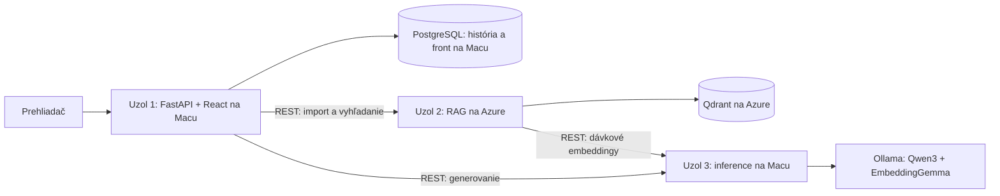

# Architektúra prvej verzie

## Hranice uzlov

- Iba aplikačný uzol pristupuje do PostgreSQL; iba RAG uzol pristupuje do Qdrantu.
- Ostatné uzly používajú výhradne autentifikované REST API. Nezdieľajú disky,
  pamäť ani priečinky. Zdrojový kód môže byť v jednom repozitári.
- Ollama počúva iba na localhost. Azure kontaktuje obalené inference API cez
  súkromnú adresu Tailscale a Bearer token.
- Docker volume patrí výhradne svojmu uzlu. Nie je to spoločné sieťové úložisko.
- Pri prvom lokálnom nácviku sú všetky služby na Macu. To ešte nie je finálne
  splnenie troch sieťovo oddelených uzlov. Cieľové dva stroje majú tri logické
  služby; s vyučujúcim treba overiť, či požaduje aj tri samostatné OS/VM.
  V takom prípade presunieme aplikačný uzol do ďalšej VM bez zmeny API.

## Import

Prehliadač → aplikačný uzol → RAG API. RAG načíta PDF v pamäti, rozdelí text
po stránkach na chunky a po dávkach 8 požiada inference API o embeddingy.
Chunk má 1100 znakov, prekrytie 160. Qdrant uchová text, PDF stranu (od 1),
názov, hash dokumentu a embedding. Originálny PDF sa na serveri neukladá.
Opakovaný import rovnakého PDF používa rovnaké identifikátory chunkov.
Import je v tejto verzii synchrónny; pri prerušení treba opakovať upload.
Čiastočne naimportované chunky môžu byť vyhľadateľné už počas importu.
Index je oddelený podľa názvu embedding modelu. Zmena modelu vyžaduje reimport.

## Otázka a front

Klient vytvorí UUID `request_id`; API ho uloží pred vrátením HTTP 202.
Jeden worker z tabuľky úloh preberá otázky, volá RAG a inference a ukladá
výsledok spolu so zdrojmi. Stavy: queued → retrieving → generating → completed.
Po chybe sa práca vráti do queued, po najviac 3 pokusoch do failed.
Ak je uzol vopred detegovaný ako offline, úloha zostáva queued a pokusy
sa nemíňajú. Po strate workera sa úloha obnoví po vypršaní 600-sekundového lease.

Jedno inference API povoľuje len jednu modelovú operáciu naraz. Po každej
operácii sa model uvoľňuje z pamäte (`keep_alive: 0s`), čo šetrí RAM za cenu
častejšieho načítania. Na GPU notebooku to neskôr upravíme podľa meraní.
Spúšťaj iba jeden proces aplikačného workera a jeden proces inference API.
Otázka čakajúca na opakovanie blokuje neskoršie otázky rovnakej relácie,
aby sa ich poradie a konverzačný kontext nepomiešali. Iné relácie pokračujú.

Idempotencia zaručuje jeden uložený výsledok pre request_id, nie presne jeden
výpočet LLM. Po páde procesu sa môže generovanie zopakovať.

## Limity prvej verzie

- Web a stavové metriky sú pre lokálnu školskú ukážku bez používateľských účtov.
  Relácie sa oddeľujú podľa session_id, nejde o autentifikáciu používateľov.
  Aplikačný port sa preto binduje iba na localhost.
- Zobrazenie odpovede používa polling. Tokenové streamovanie, cache,
  paralelný import, automatické rozlíšenie nadväzujúcich otázok a záťažový
  scenár ešte nie sú implementované.
- Výber troch najbližších chunkov nemá kalibrovaný prah relevantnosti.
  Nedostatočnosť kontextu posudzuje model; odmietnutie nezodpovedateľných otázok
  treba otestovať. Citované chunky sú dohľadateľné, pravdivosť odpovede nie je
  automaticky garantovaná.
- PDF extrakcia nespracúva vzorce ani obrázky a dvojstĺpcové články môžu
  vyžadovať doladenie poradia textu.
